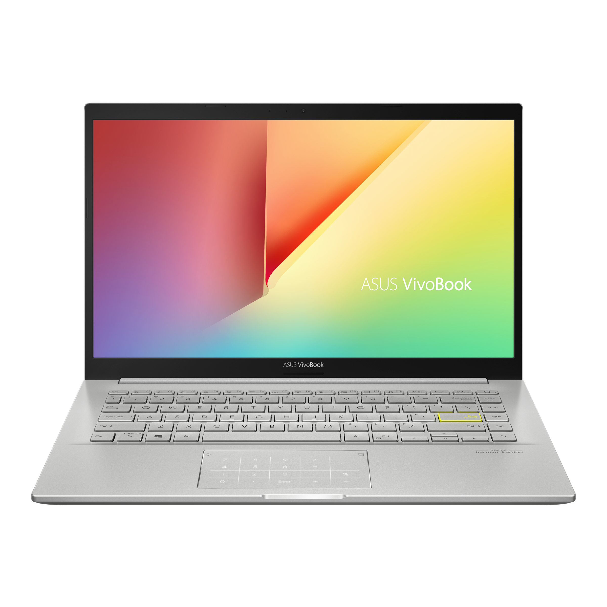
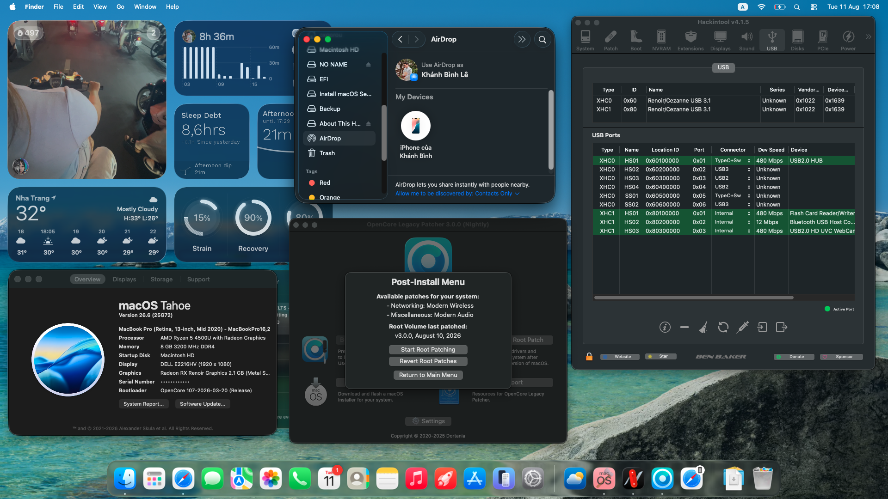

<h1 align="center">Hackintosh for ASUS M413IA</h1>

  

> [!NOTE]
> - This model features a CNVi-only lock key, preventing support for **BCM94360NG**.
> - Use [ComboJack](https://github.com/macos86/ComboJack) to fix the 3.5mm audio port issue.

# Specifications

| Hardware | Details |  
| :--- |  :--- |  
| Model | Asus VivoBook M413IA EK480T |  
| Processor | AMD Ryzen 5 4500U with Radeon Graphics |  
| RAM | 8GB Onboard RAM |  
| Graphics | Renior APU (AMD Radeon Vega 6) |  
| Storage | Intel SSDPEKNW512G8 aka SSD 660P Series |  
| Wi-Fi Card | Intel Wi-Fi 6 AX200 |  
| Audio | Realtek ALC256 |  
| Display | 14.0-inch FHD (1920 x 1080) IPS Non-Touch Screen |  
| Touchpad | ELAN I2C Touchpad (ELAN WBF included) |  
| Keyboard | PS2 Keyboard without backlight |  
| Card Reader | microSD Card Reader |  
| Camera | VGA Web Camera (720p HD) |  
| Battery | 42WHrs, 3S1P, 3-cell Li-ion |  

# Features
## Functional
| Feature | Status |  
| :--- | :--- |  
| SMBios | MacBookPro16,3 |  
| CPU Power Management | ✅ Use [ZenTune](https://github.com/HorizonUnix/ZenTune) |
| iGPU/APU | ✅ Functional |  
| Audio | ✅ Internal speakers and microphone operational (AppleALC layout 56 for ALC256 with ComboJack); HDMI audio unsupported (Use VoodooHDA instead of AppleALC) |  
| Wi-Fi and Bluetooth (Intel) | ✅ Functional with AirportItlwm (patched by OCLP for 14+) and IntelBluetoothFirmware |  
| USB | ✅ Mapped with USBToolBox |  
| Function Keys | ✅ Native |  
| TouchPad | ✅ Native |  
| Card Reader and Type-C Port | ✅ Native |  
| Sleep | ✅ Works seamlessly with BIOS modifications (S3 Sleep: On) through UMAF |  
| Battery Management | ✅ Battery health and charging limit features available |  
| IOReg & EFI | ✅ Properly configured IOReg & EFI |  

## Non-Functional
| Feature | Status |  
| :--- |:--- |  
| Apple DRM | ❌ Unsupported (Apple TV and other DRM-related content) |  
| Continuity Features (Intel) | ❌ Only limited Handoff functionality with Intel WiFi card |  
| VCN 2, HE, HD | ❌ VCN 2 (Video Core Next 2) non-functional, VCN 1 operational |  

## Function Keys

> [!NOTE]
> Function keys are mapped for direct use without needing to press Fn+Fx, akin to normal Windows environment.
> - Fn+Esc: Function key lock
> - F1: Mute
> - F2: Decrease volume
> - F3: Increase volume
> - F4: Decrease brightness
> - F5: Increase brightness
> - F6: Toggle Touchpad
> - F7: Previous track
> - F8: Show Desktop
> - F9: N/A (Ctrl + L)
> - F10: Play/Pause
> - F11: N/A (Ctrl + Shift + S)
> - F12: Next track
> - Prt Sc: F13
> - Fn + Space: Set battery charge limit to 80%/100%

# Preview

